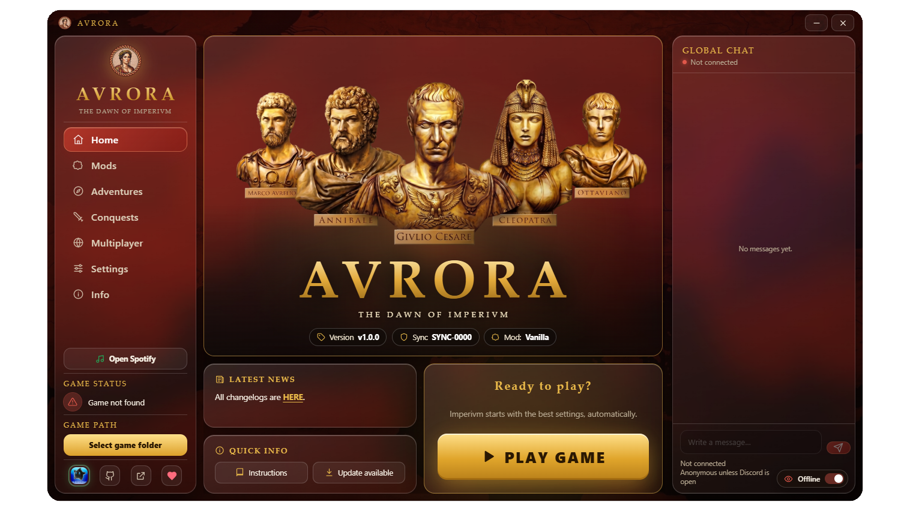
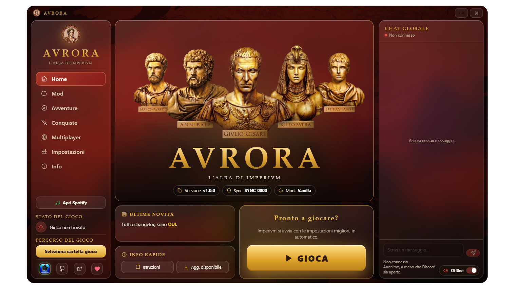

#  Avrora - The Dawn of Imperivm

  
  
  

 

  **EN:** The ultimate utility by **AlexiusItaly** to modernize, stabilize, and manage **Imperivm: Great Battles of Rome**. 
  **ES:** La utilidad definitiva de **AlexiusItaly** para modernizar, estabilizar y gestionar **Imperivm: Great Battles of Rome**. 
  **IT:** L'utilità definitiva di **AlexiusItaly** per modernizzare, stabilizzare e gestire **Imperivm: Le Grandi Battaglie di Roma**.

## 🌍 Languages & Navigation

|  [English](#english) |  [Español](#español) |  [Italiano](#italiano) |
| :--- | :--- | :--- |
| 📖 [About](#about) ⚙️ [Setup](#setup--instructions) 🚀 [Features](#main-features) 💬 [Support](#support-bugs--feedback) | 📖 [Acerca del Proyecto](#acerca-del-proyecto) ⚙️ [Instalación](#instalación) 🚀 [Funciones](#funciones-principales) 💬 [Soporte](#soporte-errores-y-comentarios) | 📖 [Informazioni](#informazioni-sul-progetto) ⚙️ [Installazione](#installazione) 🚀 [Funzionalità](#funzionalità-principali) 💬 [Supporto](#supporto-bug-e-feedback) |

---

# English

## About
**Avrora** is the ultimate evolution of the historical *Imperivm Launcher*. Built entirely on a next-generation, high-performance architecture, it is designed to run *Imperivm: Great Battles of Rome* flawlessly on modern operating systems. Avrora acts as your central hub: it fixes legacy crashes, manages multiplayer routing, integrates your music, and provides a secure, 1-click environment for all community mods and campaigns.

*This project is an unofficial community tool and does not claim ownership of Imperivm or any related intellectual property.*

## System Requirements
* **OS:** Windows 7 (32-bit) or higher.
* **Game:** A valid installation of *Imperivm: Great Battles of Rome*.

## Setup & Instructions
**No more moving files around manually!**
1. Download the latest `AVRORA.exe` release from the button at the top of this page.
2. Run the executable from anywhere on your PC (Desktop, Downloads, etc.).
3. Avrora will automatically detect your game directory if the **Steam version** is installed. If not, you can simply select the folder manually through the app—no need to place the executable inside the game folder!

## Main Features

**1. Core Architecture, Patching & Customization**
* **Next-Gen Engine & UI:** Built for incredibly low memory consumption and lightning-fast execution. Features a completely redesigned layout with dynamic backgrounds and fluid animations.
* **Native DPI Management:** Automatically bypasses Windows display scaling to prevent blurry UI elements on modern high-resolution displays.
* **1-Click Game Optimization:** Instantly applies the **4GB RAM Patch** (preventing crashes during massive sieges), injects legacy **Audio & DirectMusic Fixes**, and permanently resolves the infamous 2005 random map generation crash ("Couldn't find or parse map file"). Memory leaks are stopped, making the game engine cleaner and more stable than ever.
* **9 Hero Slots:** Seamlessly expands the game's control interface from 5 to 9 hero slots, mapped directly to keys 1-9 (special thanks to Upercat's patch).
* **Spotify Integration:** Control your Spotify playback seamlessly directly from the launcher interface, bringing custom soundtracks to your battles without needing to Alt-Tab.
* **Smart Diagnostics:** Automatic crash diagnosis based on engine log files.

**2. Cloud Adventures Manager**
* **Built-in Cloud Catalog:** Browse, download, and update custom community single-player campaigns.
* **Smart Synchronization:** Automatically detects installed maps and notifies you when map-makers release new updates.
* **Zero-Touch Installation:** Download multiple language-filtered maps at once; Avrora automatically extracts and places audio, text, and scenario files in their correct native folders.

**3. Epic Conquests Manager**
* **Large-Scale Campaigns:** Browse and download massive, community-created Conquests directly from the launcher.
* **Simplified Setup:** The system automatically handles complex file placements and integrates the campaigns seamlessly into your game without requiring manual file manipulation.

**4. Integrated Mod Manager**
* **Safe Installation:** Automatically creates a secure, AES-encrypted "Vanilla Backup" of your pristine game files before applying any modifications.
* **Instant Toggle:** Switch between the vanilla base game and massive graphical overhauls with a single click. The app handles all file swaps safely in the background.

**5. Automated Multiplayer Hub**
* **Invisible Installation:** Automatically downloads and installs Radmin VPN silently in the background if missing.
* **Smart Network Routing:** Solves the infamous "invisible lobbies" issue. With one click, the launcher configures the Windows Firewall and forces the VPN interface to Maximum Priority (Metric 1), ensuring direct routing and zero lag.
* **Real-Time Ping Monitor:** A built-in visual indicator displays your Radmin VPN ping directly in the launcher, helping you verify connection stability before starting a match.
* **Auto-Cleanup:** Safely restores default Windows network priorities the exact second you close the launcher.

**6. General Quality of Life**
* Built-in Official User Manual, accessible directly from the launcher.
* Automatic launcher update checking.
* Automatic synchronization between launcher language and game language.
* Multilingual interface: English, Spanish, Italian, Czech.

## Support, Bugs & Feedback
The goal of Avrora is to provide a simple and reliable all-in-one utility that helps players install, configure, troubleshoot, and enjoy the game with minimal effort. 

For any questions, feature requests, or bug reports, please open an issue in the **[GitHub Issues](https://github.com/AlexiusItaly/ImperivmLauncher/issues)** section of this repository. Detail your suggestion, bug, or idea, and I will reply as soon as possible!

---

# Español

## Acerca del Proyecto
**Avrora** es la evolución definitiva del histórico *Imperivm Launcher*. Construido desde cero sobre una arquitectura de nueva generación y alto rendimiento, está diseñado para ejecutar *Imperivm: Great Battles of Rome* a la perfección en sistemas operativos modernos. Avrora actúa como tu centro de mando unificado: soluciona bloqueos antiguos, gestiona el enrutamiento multijugador, integra tu música y proporciona un entorno seguro de 1 clic para todos los mods y campañas de la comunidad.

*Este proyecto es una herramienta no oficial creada por la comunidad y no reclama ningún derecho sobre Imperivm ni sobre sus contenidos.*

## Requisitos del Sistema
* **SO:** Windows 7 (32-bit) o superior.
* **Juego:** Una instalación válida de *Imperivm: Great Battles of Rome*.

## Instrucciones
**¡Ya no necesitas mover archivos manualmente!**
1. Descarga la última versión de `AVRORA.exe` desde el botón de arriba de esta página.
2. Ejecuta el archivo desde cualquier lugar de tu PC (Escritorio, Descargas, etc.).
3. Avrora detectará automáticamente la carpeta de tu juego si tienes instalada la **versión de Steam**. De lo contrario, podrás seleccionarla manualmente desde la aplicación, ¡sin necesidad de colocar el ejecutable dentro de la carpeta del juego!

## Funciones Principales

**1. Arquitectura, Parches y Personalización**
* **Motor y UI de Nueva Generación:** Construido para un consumo de memoria increíblemente bajo y una ejecución ultrarrápida. Diseño completamente renovado con fondos dinámicos y animaciones fluidas.
* **Gestión Nativa DPI:** Desactiva automáticamente el escalado de Windows para evitar interfaces y textos borrosos en monitores de alta resolución.
* **Optimización en 1 Clic:** Aplica al instante el parche de **4GB de RAM** (evitando cuelgues en batallas masivas), inyecta los **Fix de Audio y DirectMusic** (evitando cierres al iniciar), y soluciona el famoso cuelgue de mapas aleatorios de 2005 ("Couldn't find or parse map file"). Detiene las fugas de memoria RAM, logrando un motor de juego más limpio y estable que nunca.
* **9 Ranuras para Héroes:** Expande la interfaz de control de 5 a 9 ranuras para héroes (teclas 1-9), gracias al parche creado por Upercat.
* **Integración con Spotify:** Controla tu reproducción de Spotify sin problemas directamente desde la interfaz del lanzador mientras te preparas para la batalla, sin tener que hacer Alt-Tab.
* **Diagnóstico Inteligente:** Análisis automático de errores basado en registros del motor del juego.

**2. Gestor de Aventuras en la Nube**
* **Catálogo Integrado:** Explora, descarga y actualiza campañas personalizadas de la comunidad.
* **Sincronización Inteligente:** Detecta automáticamente los mapas instalados y te avisa cuando los creadores lanzan actualizaciones.
* **Instalación Automatizada:** Descarga varios mapas filtrados por idioma a la vez; Avrora extrae y coloca automáticamente los archivos de audio, texto y escenario en sus carpetas correctas.

**3. Gestor de Conquistas Épicas**
* **Campañas a Gran Escala:** Explora y descarga enormes Conquistas creadas por la comunidad directamente desde el lanzador.
* **Configuración Simplificada:** El sistema maneja automáticamente la ubicación de archivos complejos y los integra de forma fluida en tu juego sin necesidad de manipular archivos manualmente.

**4. Gestor de Mods Integrado**
* **Instalación Segura:** Crea automáticamente una "Copia Vanilla" segura y encriptada (AES) de tus archivos originales antes de aplicar cualquier mod.
* **Cambio Instantáneo:** Alterna entre el juego base y enormes actualizaciones gráficas con un solo clic. La aplicación gestiona todos los intercambios de archivos de forma segura en segundo plano.

**5. Hub Multijugador Automatizado**
* **Instalación Invisible:** Descarga e instala Radmin VPN silenciosamente en segundo plano si no lo tienes.
* **Enrutamiento de Red Inteligente:** Soluciona el problema de las "salas invisibles". Con un clic, el lanzador configura el Firewall y fuerza la interfaz VPN a Prioridad Máxima (Métrica 1), garantizando enrutamiento directo y cero lag.
* **Monitor de Ping en Tiempo Real:** Un indicador visual integrado muestra tu ping de Radmin VPN directamente en el lanzador, ayudándote a verificar la estabilidad de la conexión antes de empezar una partida.
* **Limpieza Automática:** Restaura las prioridades de red de Windows y cierra el proceso VPN en el instante exacto en que cierras el lanzador.

**6. Calidad de Vida (General)**
* Manual de usuario oficial integrado, accesible directamente desde el lanzador.
* Comprobación automática de actualizaciones del lanzador.
* Sincronización automática entre el idioma del launcher y el idioma del juego.
* Interfaz multilingüe: Español, Inglés, Italiano, Checo.

## Soporte, Errores y Comentarios
El objetivo de Avrora es ofrecer una solución sencilla y fiable que ayude a los jugadores a instalar, configurar, diagnosticar y disfrutar del juego de la forma más cómoda posible.

Para preguntas, solicitudes de nuevas funciones o reportes de errores, por favor abre un *Issue* en la sección de **[GitHub Issues](https://github.com/AlexiusItaly/ImperivmLauncher/issues)** de este repositorio. ¡Cuéntame tu sugerencia, bug o idea y te responderé lo antes posible!

---

# Italiano

## Informazioni sul Progetto
**Avrora** è l'evoluzione definitiva dello storico *Imperivm Launcher*. Sviluppato interamente da zero su un'architettura di nuova generazione ad alte prestazioni, è progettato per far girare *Imperivm: Le Grandi Battaglie di Roma* in modo impeccabile sui moderni sistemi operativi. Avrora funge da hub centrale: corregge i vecchi crash del motore, gestisce il routing multiplayer, integra la tua musica e fornisce un ambiente sicuro in 1 clic per tutte le mod e le campagne della community.

*Questo progetto è uno strumento non ufficiale realizzato per la community e non rivendica alcun diritto su Imperivm o sui relativi contenuti.*

## Requisiti di Sistema
* **OS:** Windows 7 (32-bit) o versioni successive.
* **Gioco:** Un'installazione valida di *Imperivm: Le Grandi Battaglie di Roma*.

## Installazione
**Non c'è più bisogno di spostare file manualmente!**
1. Scarica l'ultima release di `AVRORA.exe` dal pulsante in alto in questa pagina.
2. Avvia l'eseguibile da qualsiasi posizione sul tuo PC (Desktop, Download, ecc.).
3. Avrora rileverà automaticamente la cartella del gioco se è installata la **versione Steam**. In caso contrario, potrai selezionarla manualmente tramite l'app, senza più bisogno di inserire l'eseguibile nella directory di gioco!

## Funzionalità Principali

**1. Architettura, Patch e Personalizzazione**
* **Motore Next-Gen e UI:** Sviluppato per garantire un consumo di memoria bassissimo e un'esecuzione fulminea. Presenta un layout completamente riprogettato con sfondi dinamici e animazioni fluide.
* **Gestione DPI Nativa:** Disattiva automaticamente il ridimensionamento di Windows per evitare interfacce sfocate e testi sgranati sui moderni monitor ad alta risoluzione.
* **Ottimizzazione in 1 Clic:** Applica all'istante la **Patch 4GB RAM** (prevenendo crash per memoria esaurita nei grandi assedi), inietta i **Fix Audio e DirectMusic** (risolvendo le chiusure all'avvio) e corregge in modo permanente il famigerato crash delle mappe casuali del 2005 ("Couldn't find or parse map file"). Le perdite di memoria vengono arrestate, rendendo il motore di gioco più stabile che mai.
* **9 Slot Eroi:** Espande l'interfaccia di controllo da 5 a 9 slot per gli eroi, abilitando i tasti 1-9 (un ringraziamento speciale alla patch di Upercat).
* **Integrazione Spotify:** Controlla la riproduzione musicale di Spotify in modo nativo direttamente dall'interfaccia del launcher, per ascoltare le tue colonne sonore personalizzate in battaglia senza dover fare Alt-Tab.
* **Diagnostica Intelligente:** Riconoscimento automatico della causa dei crash tramite i file di log del motore di gioco.

**2. Gestore Avventure Cloud**
* **Catalogo Integrato:** Esplora, scarica e aggiorna campagne e mappe personalizzate dalla community.
* **Sincronizzazione Smart:** Rileva automaticamente le mappe installate e avvisa non appena un autore pubblica un aggiornamento.
* **Installazione Trasparente:** Scarica più mappe contemporaneamente; Avrora si occupa da solo di estrarre e posizionare audio, testi e file di scenario nelle corrette cartelle native.

**3. Gestore Conquiste Epiche**
* **Campagne su Larga Scala:** Esplora e scarica enormi Conquiste create dalla community direttamente dal launcher.
* **Setup Semplificato:** Il sistema gestisce in automatico il posizionamento dei file complessi, integrandoli perfettamente nel gioco senza richiedere alcuna manipolazione manuale.

**4. Gestore Mod Integrato**
* **Installazione Sicura:** Crea automaticamente un "Backup Vanilla" crittografato (AES) e sicuro dei file originali del gioco prima di applicare qualsiasi modifica.
* **Switch Istantaneo:** Passa dal gioco base originario alle enormi conversioni grafiche con un solo clic. L'app gestisce tutti gli scambi di file in background in totale sicurezza.

**5. Hub Multiplayer Automatizzato**
* **Installazione Invisibile:** Scarica e installa Radmin VPN in modo silenzioso in background se non è presente sul PC.
* **Routing di Rete Intelligente:** Risolve il problema delle "lobby invisibili". Con un clic, il launcher configura automaticamente il Firewall di Windows e forza la rete VPN a Priorità Massima (Metrica 1), garantendo un routing diretto e zero lag.
* **Monitoraggio Ping in Tempo Reale:** Un indicatore visivo integrato mostra il tuo ping su Radmin VPN direttamente nel launcher, aiutandoti a verificare la stabilità della connessione prima di iniziare a giocare.
* **Pulizia Automatica:** Ripristina le normali priorità di rete di Windows nell'esatto secondo in cui chiudi l'applicazione.

**6. Funzionalità Generali**
* Manuale utente ufficiale integrato, accessibile direttamente dal launcher.
* Controllo automatico degli aggiornamenti del launcher.
* Sincronizzazione automatica tra lingua del launcher e lingua del gioco.
* Interfaccia multilingua: Italiano, Inglese, Spagnolo, Ceco.

## Supporto, Bug e Feedback
L'obiettivo di Avrora è fornire uno strumento semplice e affidabile che aiuti i giocatori a installare, configurare, diagnosticare e utilizzare il gioco nel modo più semplice possibile azzerando la frustrazione tecnica.

Per domande, richieste di nuove funzionalità o segnalazioni di bug, scrivi una issue nella sezione **[GitHub Issues](https://github.com/AlexiusItaly/ImperivmLauncher/issues)** di questa pagina. Dimmi qual è il tuo suggerimento, il bug che hai trovato o la tua idea e ti risponderò il prima possibile!
